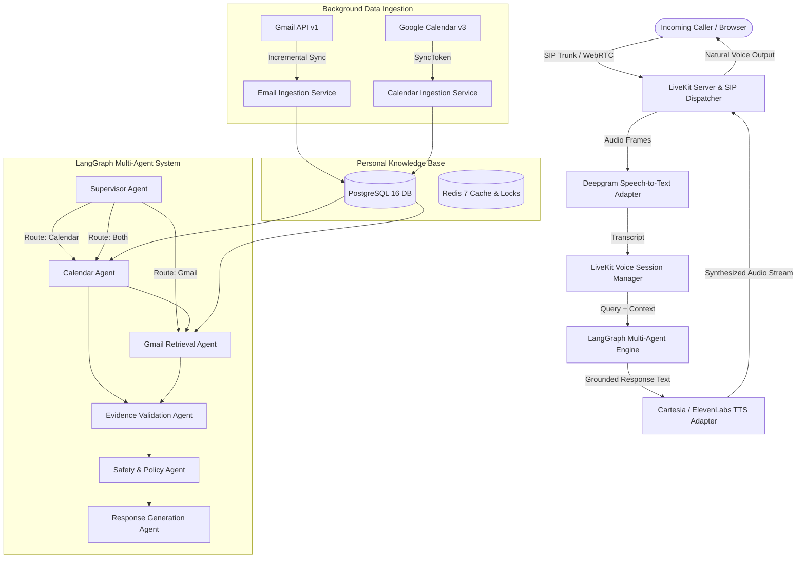
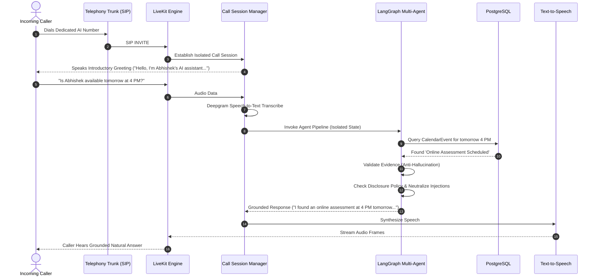

# Personal AI Twin Architecture & Design

This document details the complete end-to-end architecture, multi-agent reasoning flow, telephone call sequence, and data flow for Abhishek's Personal AI Twin.

---

## 1. End-to-End System Architecture

---

## 2. Voice Call Turn Sequence

---

## 3. Privacy, Permissions & Anti-Hallucination Guarantees

1. **Clear AI Persona Identification**: The agent introduces itself clearly on turn 1: *"Hello, I'm Abhishek's AI assistant. He is currently unavailable. How may I help you?"*
2. **Strict Read-Only Grounding**: The system queries only verified records from Abhishek's connected Gmail and primary Google Calendar.
3. **No Halucination**: If evidence is missing, the agent abstains: *"I don't have verified information about that. I can take a message for him."*
4. **Zero Write Permissions**: The AI representative cannot modify calendar events, cancel appointments, or send emails.
5. **No Credential / Financial Disclosure**: Passwords, OTPs, financial balances, and full credit card details are filtered by the Safety Agent.
6. **No Raw Audio Retention**: Raw call audio is not stored to disk by default, protecting caller privacy.
