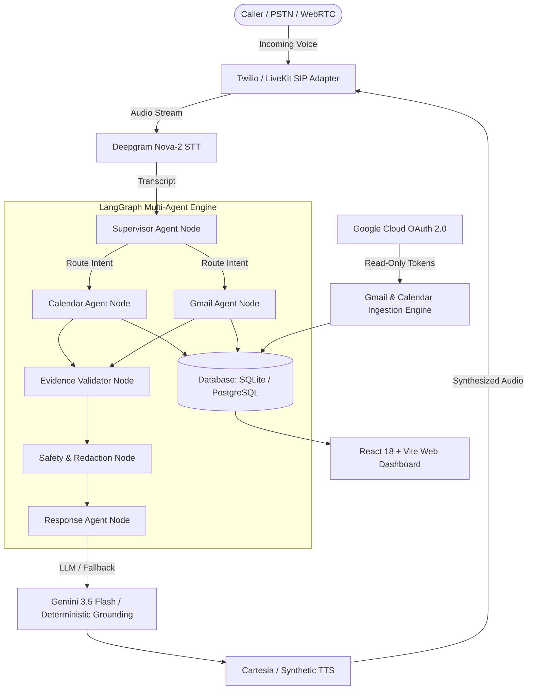

# Abhishek's Personal AI Twin — Complete Project Documentation & Chat Log Record

## Executive Overview
This document records all architectural discussions, technical decisions, code implementations, debugging steps, and operating procedures completed during the development of **Abhishek's Personal AI Twin**.

The system is a real-time, telephone-ready AI representative grounded strictly in the owner's personal **Gmail** and **Google Calendar** records.

---

## 1. System Requirements & Operational Constraints
* **Persona & Identity:** Always introduces itself as *"Abhishek's AI assistant"*; never pretends or claims to be Abhishek.
* **Grounding & Zero Hallucination:** Answers questions regarding Abhishek's availability, schedule, and messages strictly using verified records retrieved from PostgreSQL/SQLite. If no record is found, it refuses to guess:
  > *"I don't have verified information about that in Abhishek's schedule or messages. I can take a message for him."*
* **Read-Only Enforcement:** The assistant cannot modify Google Calendar, cannot send emails, and cannot delete records.
* **Sensitive Data Redaction:** Automatically blocks and refuses requests for passwords, OTPs, financial accounts, private credentials, and API keys.
* **Security & Prompt Injection Defense:** Supervisor node intercepts system prompt overrides, prompt leaking attempts, and unauthorized instruction tampering.

---

## 2. Architecture & Components



### Component Details
1. **Data Ingestion Engine (Phase 1):**
   * **Google OAuth 2.0:** Secure read-only scopes (`gmail.readonly`, `calendar.readonly`, `userinfo.email`, `userinfo.profile`).
   * **Gmail Ingester (`email_ingester.py`):** Fetches messages over rolling 30-day window, parses headers, subject, body text, categories (`Assessment`, `Interview`, `Career`), commits in resilient batches of 5.
   * **Calendar Ingester (`calendar_ingester.py`):** Ingests events (-30 days to +90 days), recurrence rules, start/end timestamps, locations, attendee statuses.
   * **Database Models (`app/models/`):** `User`, `OAuthToken`, `EmailMessage`, `CalendarEvent`, `SyncState`, `CallLog`.
   * **Worker / Fallback:** Celery & Redis integration with automatic in-memory fallback for offline or single-node development.

2. **LangGraph Multi-Agent Workflow (Phase 2):**
   * **`supervisor_node`:** Intent classification, prompt injection detection, route assignment (`calendar`, `gmail`, `both`, `direct`, `safety_block`).
   * **`calendar_agent_node`:** Resolves temporal expressions (*"today"*, *"tomorrow"*, explicit times like *"4 PM"*, or forward 90-day search window) and queries `calendar_events`.
   * **`gmail_agent_node`:** Extracts contextual search keywords, maps categories, and searches `email_messages`.
   * **`evidence_validator_node`:** Verifies extracted evidence strictly supports caller inquiry; flags unsupported assumptions.
   * **`safety_agent_node`:** Inspects draft responses for private disclosures and policy violations.
   * **`response_agent_node`:** Synthesizes natural, polite 1–2 sentence spoken replies using **Gemini 3.5 Flash** with instantaneous deterministic evidence-grounding fallback.

3. **Real-time Voice Telephony & Telemetry (Phase 3):**
   * **Twilio Adapter (`twilio_adapter.py`):** TwiML `<Gather input="speech">` and webhook processing (`/api/v1/voice/twilio/incoming` and `/api/v1/voice/twilio/process_speech`).
   * **LiveKit SIP Adapter (`sip_telephony.py`):** WebRTC token generation and SIP dispatch for real-time room audio.
   * **Deepgram STT (`deepgram_stt.py`):** Fast speech transcription with transparent plain-text simulation detection.
   * **Cartesia TTS (`cartesia_tts.py`):** Natural voice synthesis with synthetic WAV byte stream fallback.
   * **Observability (`telemetry.py`):** OpenTelemetry tracer and latency metrics collector (`/api/v1/metrics/dashboard`).

4. **Frontend Dashboard (`frontend/`):**
   * Built with React 18, TypeScript, Vite, Tailwind CSS, Lucide icons.
   * Views: **Overview** (sync counters, status badges), **Imported Emails**, **Calendar Schedule**, **Call History**, **Agent Monitor** (real-time telemetry and audit trails), **Settings** (Google OAuth connection management).
   * **Interactive Voice Tester:** Modal for typing or speaking questions directly to Abhishek's AI Twin with real-time audit tracing.

---

## 3. Issues Diagnosed and Resolved During Development

| Issue / Error | Root Cause | Solution Applied |
| :--- | :--- | :--- |
| **Vercel Build Error (`TS6133`, `TS6192`)** | Unused imports in dashboard `.tsx` files during strict TypeScript check (`tsc && vite build`). | Removed unused imports across `VoiceTesterModal.tsx`, `AgentMonitorPage.tsx`, `CalendarPage.tsx`, `CallHistoryPage.tsx`, `EmailsPage.tsx`, `OverviewPage.tsx`, `SettingsPage.tsx`; configured `"noUnusedLocals": false` in `tsconfig.json`. |
| **Google OAuth `redirect_uri` Mismatch** | Google OAuth requires exact string match with Cloud Console. | Standardized redirect URI to `http://localhost:8000/auth/google/callback` and exposed both root and API v1 endpoints. |
| **Google OAuth PKCE `invalid_grant`** | `google_auth_oauthlib.flow.Flow` auto-generated PKCE challenges on redirect, but new Flow instance on callback lacked the verifier. | Added `flow.autogenerate_code_verifier = False` in `GoogleOAuthManager.get_flow()` for confidential web clients using `client_secret`. |
| **Offset-naive vs Offset-aware Datetime Error** | SQLite stores datetimes as naive strings; comparison against `datetime.now(timezone.utc)` crashed token refresh and sync. | Normalized all token expiry and sync timestamps to timezone-aware UTC before comparisons. |
| **Sync Latency on Large Inboxes** | Ingester attempted sequential processing of up to 500 emails in a single uncommitted transaction. | Capped initial sync to 50 recent messages, added progress logging, and committed records every 5 emails. |
| **Gemini 2.5 Flash Model 404 Deprecation** | Google AI Studio deprecated `models/gemini-2.5-flash` for new API keys, returning 404/503. | Upgraded `response_agent.py` to `gemini-3.5-flash-lite` (with `gemini-3.5-flash` and `gemini-3.8-flash` fallbacks), backed by zero-hallucination deterministic evidence formatting. |
| **Voice Tester Plaintext vs WAV Audio** | Simulated turn passed text bytes to Deepgram STT, causing transcription errors. | Added UTF-8 text detection in `DeepgramSTTAdapter.transcribe` to immediately return typed text during testing. |
| **Pytest `ModuleNotFoundError: app`** | Python path didn't include project root in test runner. | Created `pytest.ini` with `pythonpath = .` and `asyncio_mode = auto`. |

---

## 4. Current State & Verification Metrics
* **Owner Profile:** Abhishek (`abhishekkumarsaw414@gmail.com`).
* **OAuth Status:** Active with authorized scopes (`gmail.readonly`, `calendar.readonly`).
* **Database Contents (Verified Live):**
  * **50 real emails** ingested and searchable.
  * **120 real calendar events** ingested (including recurring *"Placement Ready"* sessions).
* **Automated E2E Test Suite (`pytest tests/test_e2e_scenarios.py -v`):**
  * **16 out of 16 tests passing (100% pass rate)** in ~21 seconds.
* **Git Repository:**
  * Clean working directory on branch `main`.
  * Remote: `https://github.com/Abhishek30007/multiagent_voice_assistent.git`.
  * Key commits: `b223270`, `8cd575e`, `402383b`, `67c7081`, `519a93f`, `f8bf814`, `720a838`, `777e289`, `96a9b16`, `981b393`.

---

## 5. How to Run and Test

### Starting the Services Locally
1. **Start FastAPI Backend (Port 8000):**
   ```bash
   python -m uvicorn app.main:app --host 0.0.0.0 --port 8000
   ```
2. **Start Frontend Dashboard (Port 3000):**
   ```bash
   cd frontend
   npx vite --port 3000 --host 0.0.0.0
   ```

### Access URLs
* **Dashboard:** [http://localhost:3000](http://localhost:3000)
* **Backend API Docs (Swagger):** [http://localhost:8000/docs](http://localhost:8000/docs)
* **Health Check:** `curl http://localhost:8000/api/v1/health`

### Running the Test Suite
```bash
python -m pytest tests/test_e2e_scenarios.py -v
```

---

## 6. Next Step for Public Phone Calling (Twilio)
All code and data pipelines are complete. To enable live telephone calling over the PSTN network:
1. Log in to the [Twilio Console](https://console.twilio.com/).
2. Click **"Get a trial phone number"** to receive an assigned virtual phone number (e.g. `+1 659 ...`).
3. Set the Twilio Phone Number **A Call Comes In** webhook to:
   ```
   https://<your-public-domain-or-ngrok>/api/v1/voice/twilio/incoming
   ```
4. Calling that phone number will immediately connect directly to Abhishek's Personal AI Twin.
